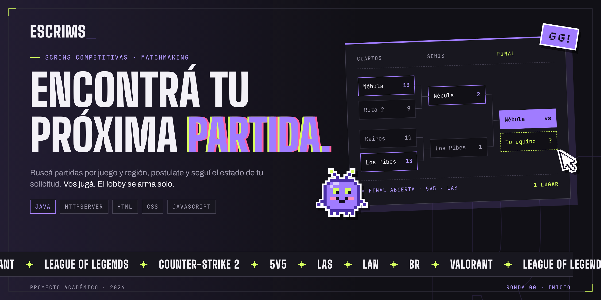

<p align="center">
  
</p>

<p align="center">
  <strong>Plataforma de organización de partidas competitivas de eSports</strong>
</p>

<p align="center">
  Trabajo Práctico Final — Patrones de Diseño<br>
  Universidad Argentina de la Empresa (UADE) · Tecnicatura en Desarrollo de Software
</p>

<p align="center">
  <strong>Integrantes:</strong> Evangelina Ovelar (LU 1101756) y Luka Peralta (LU 1170204)
</p>

<p align="center">
  <a href="https://escrims-demo.onrender.com/">
    
  </a>
</p>

---

## Sobre el proyecto

**eScrims** es una aplicación web integral desarrollada en Java (sin frameworks externos) para organizar y gestionar partidas competitivas de videojuegos (*scrims*) de **Valorant**, **League of Legends** y **Counter-Strike 2**.

Permite a los jugadores explorar partidas disponibles, postularse y confirmar su participación individual en el lobby. Los organizadores cuentan con herramientas para emparejar candidatos mediante algoritmos inteligentes, gestionar solicitudes y controlar de punta a punta el ciclo de vida de cada encuentro con consistencia transaccional.

## Tecnologías utilizadas

- **Backend:** Java 27 (servidor HTTP nativo y JDBC transaccional con `SELECT ... FOR UPDATE`).
- **Frontend:** HTML5, CSS3 y JavaScript moderno (diseño web responsive).
- **Base de datos:** PostgreSQL mediante Supabase.
- **Despliegue y CI/CD:** Contenedor Docker desplegado en Render.
- **Seguridad:** Hashing PBKDF2 con sal, cookies `HttpOnly; SameSite=Strict`, validación de `Origin` y rate limiting de autenticación.

## Funcionalidades principales

- **Gestión de Cuentas y Seguridad:** Registro, login, control de acceso por roles (`JUGADOR` y `ORGANIZADOR`) y limitador de fuerza bruta (5 intentos / 15 min).
- **Exploración y Filtrado:** Búsqueda avanzada de partidas por juego, formato (1v1, 3v3, 5v5), región, rango y disponibilidad de cupos.
- **Postulaciones y Matchmaking:** Envío de solicitudes con validación de región y rango. Recomendación de candidatos ordenada por compatibilidad.
- **Gestión del Lobby y Confirmaciones:** Confirmación individual por participante aceptado con bloqueo pesimista por concurrencia. Transición automática a *Confirmado* al completarse los cupos.
- **Ciclo de Vida Persistente (State):** Transiciones estrictas (*Buscando jugadores → Lobby armado → Confirmado → En juego → Finalizado / Cancelado*).
- **Planificador Automático (Scheduler):** Hilo daemon en segundo plano que inicia partidas confirmadas en su horario y finaliza las que superaron su duración.
- **Auditoría Transaccional:** Registro atómico de cada cambio de estado (quién, cuándo, estado previo y nuevo) en base de datos.
- **Notificaciones Resilientes:** Desacoplamiento de eventos de dominio con cola en memoria y retroceso exponencial (1s, 2s, 4s) ante fallos.

## Patrones de diseño implementados

| Patrón | Tipo | Aplicación en eScrims |
|---|---|---|
| **State** | Comportamiento | Control riguroso del ciclo de vida de la Scrim. Evita transiciones inválidas y sincroniza el estado en PostgreSQL mediante rehidratación polimórfica (`ScrimContext.desdeNombre`). |
| **Strategy** | Comportamiento | Algoritmos intercambiables de emparejamiento: por MMR (`ByMMRStrategy`), por latencia (`ByLatencyStrategy`), por historial (`ByHistoryStrategy`) y combinación ponderada 50/30/20 (`HybridStrategy`). |
| **Observer** | Comportamiento | Desacoplamiento de eventos de dominio (`EventoScrim`). Los cambios de estado notifican a los interesados inmediatamente después del commit de la transacción. |
| **Abstract Factory** | Creación | Creación de familias de notificadores según el entorno de ejecución (`FabricaDesarrollo` vs `FabricaProduccion`). |
| **Facade** | Estructural | `EscrimsFacade` unifica y simplifica las operaciones de scrims, postulaciones, lobby y matchmaking, reduciendo el acoplamiento del servidor web. |

## Estructura del proyecto

```text
src/
├── controller/      # Servidor HTTP nativo, endpoints REST y planificador
├── domain/          # Entidades de negocio (Scrim, Usuario, Confirmacion, Postulacion, Equipo)
├── facade/          # Fachada unificada del sistema (EscrimsFacade)
├── factory/         # Familias de notificadores (Abstract Factory)
├── matchmaking/     # Estrategias de emparejamiento y cálculo de compatibilidad (Strategy)
├── observer/        # Gestor y eventos de cambio de estado (Observer)
├── persistence/     # Repositorios JDBC, transacciones FOR UPDATE y auditoría
├── pruebas/         # Pruebas de integración, concurrencia (6 hilos) y rendimiento (500 candidatos)
├── service/         # Servicios de negocio, autenticación y cola con reintentos exponenciales
├── state/           # Contexto y estados concretos del ciclo de vida (State)
└── web/             # Interfaz web (HTML5 semántico, CSS responsivo y JS modular)
sql/
└── confirmaciones.sql  # DDL de tablas de confirmaciones del lobby y auditoría
```

## Servicios API principales

| Método | Ruta | Rol requerido | Descripción |
|---|---|---|---|
| `POST` | `/api/auth/register` | Público | Registro de nuevos usuarios con PBKDF2 |
| `POST` | `/api/auth/login` | Público | Autenticación y apertura de sesión |
| `GET` / `POST` | `/api/scrims` | Público / Organizador | Listado con filtros y creación de partidas |
| `GET` / `POST` | `/api/postulaciones` | Jugador | Consultar mis postulaciones y postularme |
| `GET` / `POST` | `/api/organizador/postulaciones` | Organizador | Listar postulaciones y aceptar/rechazar |
| `GET` | `/api/organizador/recomendaciones` | Organizador | Obtener candidatos rankeados por Strategy |
| `GET` | `/api/lobby?scrimId=X` | Participante / Org. | Consultar estado del lobby y confirmaciones |
| `POST` | `/api/lobby/confirmar` | Jugador aceptado | Confirmar asistencia individual en el lobby |
| `POST` | `/api/organizador/lobby` | Organizador | Iniciar, finalizar o cancelar partida manualmente |

## Ejecución local

**Requisitos:** Java JDK 27, Git y acceso a PostgreSQL (Supabase o local).

1. **Clonar el repositorio:**
   ```bash
   git clone https://github.com/eovelar/TPO-PROCESOS-ESCRIMS.git
   cd TPO-PROCESOS-ESCRIMS
   ```

2. **Base de datos:**
   Ejecutar en PostgreSQL/Supabase el script de tablas auxiliares:
   ```sql
   -- Contenido de sql/confirmaciones.sql (crea public.confirmaciones y public.auditoria_estados)
   ```

3. **Configurar variables de entorno:**
   ```text
   DB_HOST=<host_de_postgres>
   DB_PORT=5432
   DB_NAME=postgres
   DB_USER=<usuario>
   DB_PASSWORD=<password>
   ```

4. **Compilar y ejecutar:**
   ```bash
   javac -cp "lib/postgresql-42.7.14.jar" -d out $(find src -name "*.java")
   java -cp "out:lib/postgresql-42.7.14.jar" controller.ServidorWeb
   ```
   *(En Windows CMD / PowerShell ejecutar `controller.ServidorWeb.main()` directamente desde IntelliJ IDEA).*

5. Abrir la aplicación en el navegador: **http://localhost:9090**.

## Batería de Pruebas

El paquete `src/pruebas/` contiene pruebas automatizadas para verificar el sistema:
- **`PruebaLobbyIntegracion`:** 45 verificaciones que validan el ciclo completo, persistencia post-reinicio, rechazo de dobles confirmaciones, transiciones inválidas y 6 confirmaciones simultáneas concurrentes con `ExecutorService`.
- **`PruebaRendimientoMatchmaking`:** Simulación con 500 candidatos concurrentes ejecutada 20 veces, logrando un promedio de emparejamiento de ~1.07 ms (ampliamente inferior al requisito de 2.000 ms).
- **`PruebaColaNotificaciones`:** Verificación de resiliencia y retroceso exponencial ante fallas temporales.

---

<p align="center">
  <sub>eScrims · Proyecto académico · UADE · 2026</sub>
</p>
