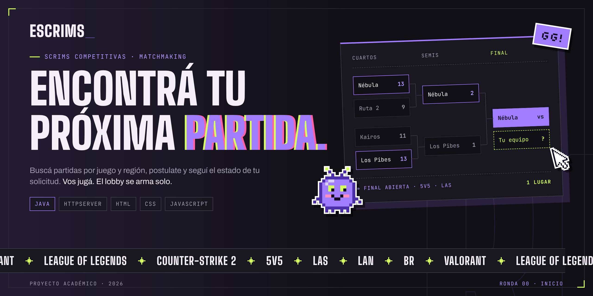

<p align="center">
  
</p>

<p align="center">
  <strong>Plataforma de organización de partidas competitivas de eSports</strong>
</p>

<p align="center">
  Trabajo Práctico Final — Patrones de Diseño<br>
  Universidad Argentina de la Empresa (UADE) · Tecnicatura en Desarrollo de Software
</p>

<p align="center">
  <strong>Integrantes:</strong> Evangelina Ovelar y Luka Peralta
</p>

<p align="center">
  <a href="https://escrims-demo.onrender.com/">
    
  </a>
</p>

---

## Sobre el proyecto

**eScrims** es una aplicación web desarrollada en Java para organizar y gestionar partidas competitivas de videojuegos (*scrims*).

Permite a los jugadores explorar partidas disponibles, registrarse y postularse según su región y rango. Los organizadores pueden gestionar solicitudes, administrar participantes y controlar los cupos de cada encuentro.

El proyecto aplica principios de programación orientada a objetos, arquitectura por capas y patrones de diseño para mantener un código modular y extensible.

## Tecnologías utilizadas

- **Backend:** Java 27, servidor HTTP nativo y JDBC.
- **Frontend:** HTML5, CSS3 y JavaScript.
- **Base de datos:** PostgreSQL mediante Supabase.
- **Despliegue:** Docker y Render.
- **Herramientas:** IntelliJ IDEA, Git y GitHub.

## Funcionalidades principales

- Registro e inicio de sesión con contraseñas protegidas mediante PBKDF2.
- Exploración y filtrado de partidas por juego y región.
- Postulaciones con validación de rango, región y disponibilidad.
- Gestión de solicitudes y cupos desde el panel del organizador.
- Persistencia de usuarios, partidas y postulaciones en PostgreSQL.
- Gestión del ciclo de vida de las scrims.
- Emparejamiento mediante estrategias intercambiables.
- Notificaciones simuladas ante cambios de estado.

## Patrones de diseño

| Patrón | Aplicación |
|---|---|
| **State** | Gestión de estados de una scrim: búsqueda, lobby, confirmación, juego y finalización. |
| **Strategy** | Algoritmos de emparejamiento por rango/MMR, latencia e historial. |
| **Observer** | Notificación de eventos y cambios de estado. |
| **Abstract Factory** | Creación de notificadores según el entorno y tipo de destinatario. |

## Estructura del proyecto

```text
src/
├── controller/      # servidor HTTP y endpoints
├── domain/          # entidades del negocio
├── service/         # lógica de negocio
├── persistence/     # conexión y repositorios JDBC
├── state/           # patrón State
├── matchmaking/     # patrón Strategy
├── observer/        # patrón Observer
├── factory/         # patrón Abstract Factory
├── pruebas/         # pruebas funcionales
└── web/             # HTML, CSS y JavaScript
```

## Ejecución local

**Requisitos:** Java JDK 27, IntelliJ IDEA y acceso a PostgreSQL.

1. Clonar el repositorio:

   ```bash
   git clone https://github.com/eovelar/TPO-PROCESOS-ESCRIMS.git
   ```

2. Abrir el proyecto en IntelliJ IDEA y configurar las variables de entorno:

   ```text
   DB_HOST
   DB_PORT
   DB_NAME
   DB_USER
   DB_PASSWORD
   ```

3. Ejecutar `controller.ServidorWeb.main()`.

4. Abrir la aplicación en **http://localhost:9090**.

---

<p align="center">
  <sub>eScrims · Proyecto académico · UADE · 2026</sub>
</p>
